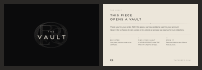

# ORBES — THE VAULT CARD

La carte THE VAULT va dans la boîte de chaque pièce achetée, à côté de la MINT CERTIFICATE et au même format, 95 × 62 mm. Elle dit au client qu'avec sa pièce nous avons ajouté un vault à son compte, et comment l'ouvrir. Une seule carte pour tout le monde : ni numéro, ni nom. Le prestataire logistique l'imprime quand il en a besoin, avec les fichiers de ce document.

Liens : [kit emballage](PACKAGING-KIT.md) · [procédure de vente et d'expédition](SALES-PLAYBOOK.md) · le dessin : `genome/src/server/render/vault-card.ts`, les fichiers : `genome/scripts/vault-card.ts`.

## 1. Ce qu'elle dit

La carte est imprimée en anglais, comme l'application. Ses mots, tels que `VAULT_CARD_COPY` les dessine :

| Face | Texte |
|---|---|
| Recto | THE VAULT, sur le monogramme gravé ; aucun autre mot |
| Verso, en tête | THE VAULT |
| Titre, sur deux lignes | THIS PIECE / OPENS A VAULT |
| Sous l'horizon et son point | Thank you for your order. With this piece, we have added a vault to your account. |
| Ligne suivante | Open it for a chance to win a prize or to unlock an access we reserve for our collectors. |
| Étape I | REGISTER · Your piece, with the code on its certificate. |
| Étape II | FIND YOUR VAULT · In YOUR ACCOUNT, under THE VAULT. It is kept for 30 days. |
| Étape III | OPEN IT · Press and hold its door. What it holds is yours. |
| Pied | le monogramme ORBES · THEORBES.COM |

Un trait fin, sans point, sépare les deux phrases des trois étapes.

En français, pour relecture (la carte reste en anglais) : CETTE PIÈCE OUVRE UN VAULT · Merci pour votre commande. Avec cette pièce, nous avons ajouté un vault à votre compte. · Ouvrez-le pour tenter de gagner un prix ou de débloquer un accès que nous réservons à nos collectionneurs. · I ENREGISTREZ : votre pièce, avec le code de son certificat. · II TROUVEZ VOTRE VAULT : dans YOUR ACCOUNT, sous THE VAULT ; il y est gardé 30 jours. · III OUVREZ-LE : appuyez sur sa porte sans relâcher ; ce qu'il contient est à vous.

## 2. Quand elle va dans le colis

- Au colisage, la checklist de la console (`Logistics`, la commande à préparer) porte la ligne `THE VAULT CARD` pour chaque commande dont la pièce ouvre un vault à son enregistrement : une commande LIVE, DRAW ou SALON, et une commande VAULT achetée avec son droit d'achat. On la coche à la main quand la carte est dans la boîte ; `Packed` est refusé tant qu'elle ne l'est pas.
- Jamais pour un cadeau de bienvenue (GIFT), une pièce gagnée gratuitement dans un vault (commande VAULT à 0) ou le remplacement d'un échange (EXCHANGE) : la carte dirait « nous avons ajouté un vault » alors qu'aucun n'est ajouté.
- Pas de ligne non plus tant que la source PIECE de CLUB > THE VAULT est coupée.
- Le bordereau du colis le rappelle sous la pièce : `Vault card · THE VAULT CARD`.

## 3. Comment l'imprimer

1. Ouvrir la planche A4 : [vault-card-sheet.pdf](../assets/vault-card-sheet.pdf). La page 1 porte huit rectos, la page 2 les huit versos.
2. Imprimer en recto verso, retournement **bord long**, à **taille réelle** (100 %, sans « ajuster à la page ») : la barre de 10 mm en pied de page doit mesurer 10 mm. Sur un papier ivoire, comme la MINT CERTIFICATE : le verso est le papier lui-même, seul le texte y est imprimé.
3. Couper sur les traits de coupe : huit cartes de 95 × 62 mm, comme la MINT CERTIFICATE. Le noir du recto dépasse de 3 mm autour de la grille, pour qu'aucun bord blanc ne reste après la coupe.
4. Vérifier une carte : le recto noir avec THE VAULT au centre, le verso dans le bon sens.

Pour un imprimeur : la carte seule, [vault-card-single.pdf](../assets/vault-card-single.pdf), le recto puis le verso, chaque page de 101 × 68 mm avec sa zone de coupe (TrimBox) de 95 × 62 mm et 3 mm de fond perdu sur le noir du recto.

Les deux fichiers sont en noir seul (K) : le noir du recto est un K 100, le monogramme gravé et les gris du verso sont des teintes de K ; aucune police n'y est incluse, le texte est dessiné. Ils sont refaits à l'identique par `npx tsx scripts/vault-card.ts` (depuis `genome/`), qui écrit aussi l'image ci-dessus.
